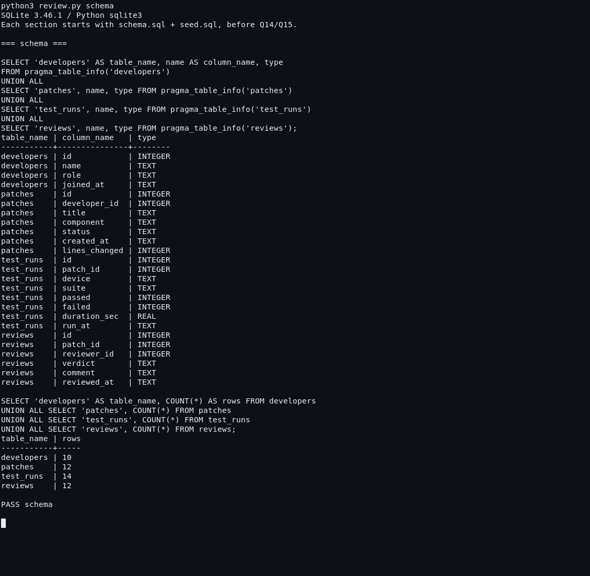
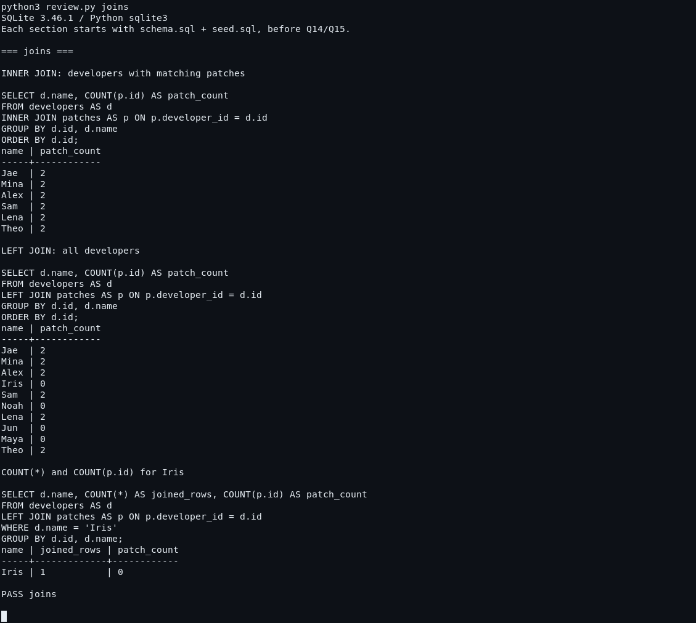
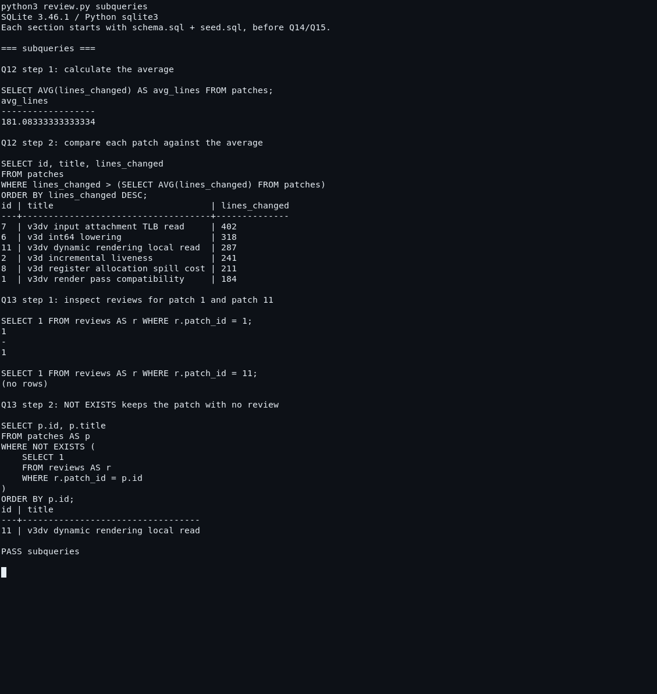
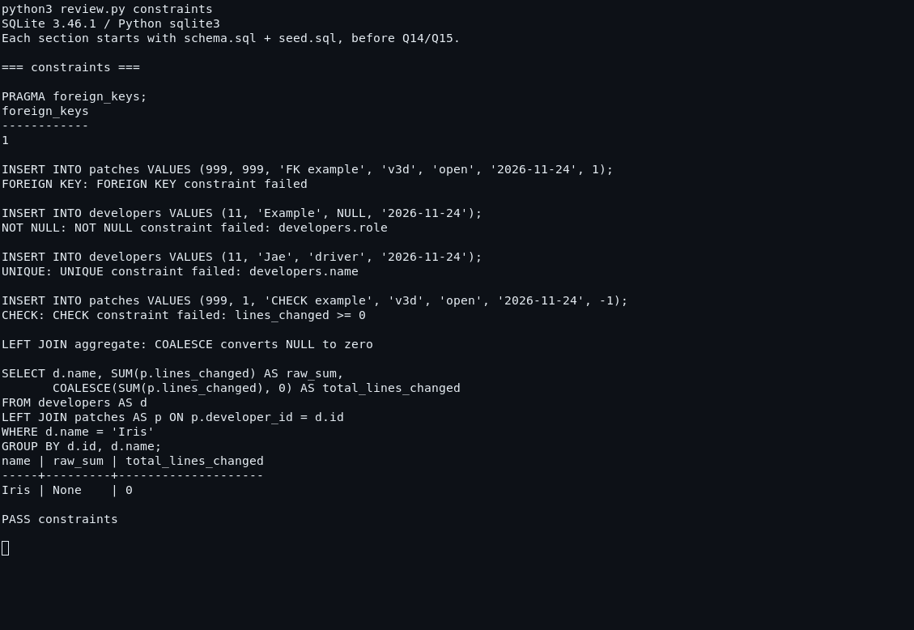
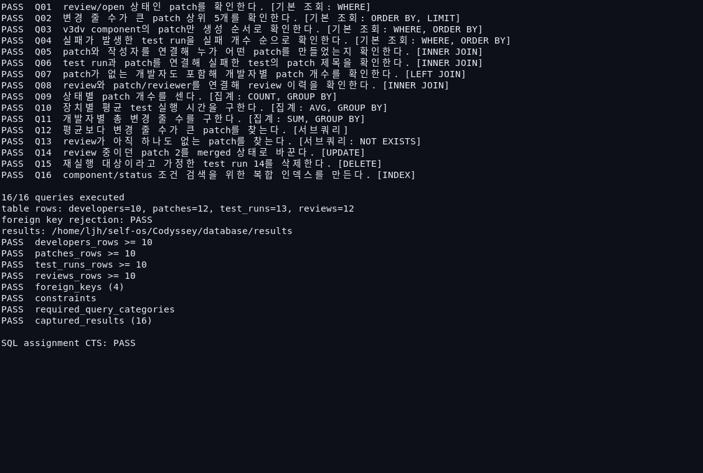

# Mesa Patch Drawer

Mesa patch의 작성자, test 결과, review 이력을 저장하는 SQLite 실습이다.
테이블을 만들고 sample data에 SQL 16개를 실행해 조회·수정 결과를 확인한다.

Python 3의 표준 `sqlite3` 모듈을 사용한다. `verify.py`가 DB를 생성하고 SQL을 실행해
`results/`에 결과를 저장한다. 실행 화면은 `screenshots/`에서 확인할 수 있다.

## 구조

```text
schema.sql      4개 table, PK/FK/constraint
seed.sql        table마다 10행 이상의 sample data
queries.sql     기본/조인/집계/서브쿼리/UPDATE/DELETE/INDEX 16개
verify.py       DB 재생성 + 16개 query 실행 + result 캡처
cts.py          제출 조건 검사
review.py       컬럼 타입·JOIN·subquery·제약조건 설명용 실행
results/        Q01.txt ... Q16.txt
screenshots/    실제 SQL 실행 화면 5장
```

실행용 `mesa_drawer.db`는 `schema.sql`과 `seed.sql`에서 재생성한다.
Git에는 SQL, 실행 스크립트와 결과 증빙을 관리한다.

## 관계

```text
developers 1 ─── N patches
                    │
                    ├── 1 ─── N test_runs
                    │
                    └── 1 ─── N reviews

developers 1 ─────────── N reviews   (reviewer)
```

테이블은 네 개다.

- `developers`: 개발자. `name`은 `UNIQUE`, 주요 필드는 `NOT NULL`이다.
- `patches`: patch 메타데이터. `developer_id -> developers.id`.
- `test_runs`: patch별 test 결과. `patch_id -> patches.id`.
- `reviews`: patch review. `patch_id -> patches.id`, `reviewer_id -> developers.id`.

`PK`는 한 행을 구분하는 ID이고, `FK`는 다른 테이블의 PK를 참조하는 연결이다.
예를 들어 한 developer row를 여러 patch row가 `developer_id`로 가리키므로
`developer 1 : N patch` 관계가 된다.

개발자 정보는 `developers`에 한 번 저장하고 patch와 review에서 ID로 참조한다.
test와 review도 별도 테이블에 행을 추가하므로 patch 하나에 여러 실행·검토 기록을
연결할 수 있다. FK는 이 연결의 참조 무결성을 유지한다.

## 컬럼 타입과 선택 이유

| 테이블 | `INTEGER` | `REAL` | `TEXT` |
|---|---|---|---|
| `developers` | `id` | — | `name`, `role`, `joined_at` |
| `patches` | `id`, `developer_id`, `lines_changed` | — | `title`, `component`, `status`, `created_at` |
| `test_runs` | `id`, `patch_id`, `passed`, `failed` | `duration_sec` | `device`, `suite`, `run_at` |
| `reviews` | `id`, `patch_id`, `reviewer_id` | — | `verdict`, `comment`, `reviewed_at` |

ID와 행 수·변경 줄 수는 정수라 `INTEGER`를 사용했다. `duration_sec`는 `93.2`초처럼
소수 부분을 담기 위해 `REAL`을 사용했다. 이름·제목·상태·설명은 `TEXT`로 저장한다.

날짜는 `YYYY-MM-DD`, 시각은 `YYYY-MM-DD HH:MM:SS` 형식의 `TEXT`다. 같은 형식으로
저장한 컬럼은 문자열 정렬로 날짜 순서도 확인할 수 있다.

SQLite는 선언 타입의 친화도에 따라 값을 저장한다. 이 스키마의 필수 입력·중복·값
범위는 `NOT NULL`, `UNIQUE`, `CHECK`로 정한다. 예를 들어 `status`는 네 가지 상태,
`lines_changed`와 `duration_sec`는 0 이상의 값을 허용한다. 날짜 형식은 sample data의
입력 규칙으로 관리한다.

`test_runs.patch_id`와 `reviews.patch_id`의 `ON DELETE CASCADE`는 patch 삭제 시 관련
test·review 행도 함께 삭제한다. 개발자에 대한 FK는 참조 중인 개발자의 삭제를 막는다.

## 실행

Python 3에서 다음 명령으로 실행한다.

```sh
python3 verify.py
```

이 명령은 매번 `mesa_drawer.db`를 새로 만들고 다음 순서로 실행한다.

```text
schema.sql
   ↓
seed.sql
   ↓
queries.sql Q01 ~ Q16
   ↓
results/Q01.txt ~ Q16.txt
```

제출 전 검사는:

```sh
python3 cts.py
```

CTS는 각 table 10행 이상, FK 정의, 필수 제약조건·query 구문과 결과 파일 개수를
검사한다. `verify.py`는 FK를 위반하는 patch INSERT의 거부도 확인한다.

설명에 사용한 SQL과 결과는 다음 명령으로 재현한다.

```sh
python3 review.py
```

`review.py`는 항목마다 메모리 DB에 schema와 seed를 새로 읽는다. `schema`, `joins`,
`subqueries`, `constraints`를 인자로 주면 해당 항목을 실행한다. 전체 출력은
[`results/review.txt`](results/review.txt), CTS 출력은 [`results/cts.txt`](results/cts.txt)에 있다.

## Query 구성

16개를 아래처럼 나눴다.

```text
Q01-Q04  기본 조회: WHERE / ORDER BY / LIMIT
Q05-Q08  JOIN: INNER JOIN / LEFT JOIN
Q09-Q11  집계: COUNT / AVG / SUM + GROUP BY
Q12-Q13  subquery / NOT EXISTS
Q14      UPDATE
Q15      DELETE
Q16      CREATE INDEX
```

`Q16`의 `idx_patches_component_status`는 component/status 조건으로 patch를 반복
검색할 때 전체 row를 모두 확인하는 일을 줄이기 위한 인덱스다.

각 query 위에 확인할 내용을 설명하고, 같은 번호의 `results/Qxx.txt`에 SQL과 실행
결과를 저장한다. 결과 텍스트와 terminal screenshot을 함께 제출 증빙으로 사용한다.

## INNER JOIN과 LEFT JOIN

개발자별 patch 수를 구하는 Q07을 기준으로 두 JOIN을 비교한다.

```sql
SELECT d.name, COUNT(p.id) AS patch_count
FROM developers AS d
INNER JOIN patches AS p ON p.developer_id = d.id
GROUP BY d.id, d.name
ORDER BY d.id;
```

`INNER JOIN`은 개발자와 patch가 연결된 행을 가져온다. sample data에서는 patch를
작성한 개발자 6명이 나오고 각자의 patch 수는 2다.

```sql
SELECT d.name, COUNT(p.id) AS patch_count
FROM developers AS d
LEFT JOIN patches AS p ON p.developer_id = d.id
GROUP BY d.id, d.name
ORDER BY d.id;
```

`LEFT JOIN`은 왼쪽의 개발자 10명을 모두 유지한다. patch가 있는 개발자는 2,
Iris·Noah·Jun·Maya는 0으로 나온다. patch 0개인 개발자 행의 `p.id`는 `NULL`이다.

`COUNT(p.id)`는 값이 있는 patch ID를 센다. `COUNT(*)`는 JOIN 결과의 행 자체를 세기
때문에 Iris도 1로 나온다. Q07에서는 개발자별 실제 patch 수를 구하려고 `COUNT(p.id)`를
사용했다. `python3 review.py joins`에서 두 JOIN과 COUNT의 차이를 확인할 수 있다.

## 복잡한 query를 나누어 읽기

### Q12: 평균보다 변경 줄 수가 큰 patch

먼저 비교 기준인 전체 평균을 구한다.

```sql
SELECT AVG(lines_changed) AS avg_lines FROM patches;
```

sample data의 평균은 약 181.08줄이다. 이 SELECT를 조건에 넣어 각 patch와 비교한다.

```sql
SELECT id, title, lines_changed
FROM patches
WHERE lines_changed > (SELECT AVG(lines_changed) FROM patches)
ORDER BY lines_changed DESC;
```

결과는 변경 줄 수 순서로 ID `7, 6, 11, 2, 8, 1`의 6개 patch다. 내부 SELECT가 기준값을
만들고, 바깥 SELECT가 조건에 맞는 patch를 고른다.

### Q13: review 등록을 기다리는 patch

patch 하나에 review가 있는지 먼저 확인한다.

```sql
SELECT 1 FROM reviews AS r WHERE r.patch_id = 1;
SELECT 1 FROM reviews AS r WHERE r.patch_id = 11;
```

patch 1은 review가 있어 한 행이 나오고, patch 11은 결과가 0행이다. `SELECT 1`은
조건에 맞는 행의 존재를 확인하기 위한 상수 선택이다.

```sql
SELECT p.id, p.title
FROM patches AS p
WHERE NOT EXISTS (
    SELECT 1
    FROM reviews AS r
    WHERE r.patch_id = p.id
)
ORDER BY p.id;
```

바깥 query가 patch를 하나씩 보고, 내부 query는 그 patch의 `p.id`로 review를 찾는다.
`NOT EXISTS`는 내부 결과가 0행인 patch를 남긴다. 이처럼 바깥 행의 값을 참조하는
SELECT가 상관 서브쿼리다. 결과는 patch 11 한 개다.

### Q08: 세 테이블을 연결하는 순서

`reviews r`에서 시작해 `r.patch_id = p.id`로 patch 제목을 가져온다. 이어서
`r.reviewer_id = d.id`로 리뷰어 이름을 가져온다. 마지막으로 리뷰 ID·patch 제목·리뷰어·
판정만 SELECT하고 `r.id`로 정렬한다. 작성자는 `patches.developer_id`, 리뷰어는
`reviews.reviewer_id`라는 서로 다른 관계를 따른다.

## 난관과 해결 기록

구현과 검증에서 확인한 쟁점 및 재현 결과를 정리했다.

| 쟁점 | 처리 | 확인 결과 |
|---|---|---|
| SQLite 연결에서 FK 검사를 활성화해야 한다. | 연결 직후 `PRAGMA foreign_keys = ON`을 실행한다. | developer ID 999를 참조한 INSERT가 `FOREIGN KEY constraint failed`로 거부된다. |
| LEFT JOIN에서 patch 0개인 개발자의 수를 정확히 세어야 한다. | `COUNT(p.id)`로 실제 patch ID를 센다. | Iris의 `COUNT(*)`는 1, `COUNT(p.id)`는 0이다. |
| patch 0개인 개발자의 `SUM` 결과는 `NULL`이다. | Q11에서 `COALESCE(SUM(p.lines_changed), 0)`으로 표시값을 정한다. | Iris의 원래 합계는 `NULL`, 변환한 합계는 0이다. |
| UPDATE·DELETE를 포함한 실습은 실행 시점에 따라 값이 달라진다. | `verify.py`가 DB를 재생성한 뒤 Q01부터 순서대로 실행한다. | seed의 test 14행이 Q15 뒤 13행이 된다. 설명용 실행은 seed 상태에서 시작한다. |

`python3 review.py constraints`는 FK·NOT NULL·UNIQUE·CHECK를 위반하는 INSERT 각각의
오류 종류를 확인하고, `SUM`과 `COALESCE` 결과도 출력한다. Python `sqlite3`의 출력에서
`None`은 SQL의 `NULL`에 해당한다.

## 실행 screenshot

각 이미지는 해당 Python 명령을 실행한 terminal 창을 캡처한 것이다.
설명용 `review.py`는 seed 상태를 사용하므로 test가 14행이고, Q15까지 실행하는
CTS의 최종 test 수는 13행이다.

컬럼 타입과 seed 행 수 — `python3 review.py schema`



INNER JOIN·LEFT JOIN·COUNT 비교 — `python3 review.py joins`



평균 subquery와 NOT EXISTS의 단계별 실행 — `python3 review.py subqueries`



제약조건 위반과 NULL 집계 처리 — `python3 review.py constraints`



SQL 16개 실행과 제출 조건 검사 — `python3 cts.py`



## SQL 기본 구문

주요 구문의 역할은 다음과 같다.

```sql
SELECT ... FROM ... WHERE ...;   -- 가져오기
INSERT INTO ... VALUES ...;      -- 넣기
UPDATE ... SET ... WHERE ...;    -- 바꾸기
DELETE FROM ... WHERE ...;       -- 지우기
JOIN ... ON ...                  -- FK로 연결된 표를 같이 보기
```

`GROUP BY`는 같은 종류끼리 묶어서 `COUNT`, `SUM`, `AVG` 같은 집계를 하기 위한
구문이다. subquery는 SQL 안에서 다른 `SELECT` 결과를 조건으로 다시 쓰는 형태다.

## 제출 파일

필수 제출물은 그대로 대응된다.

```text
schema.sql
seed.sql
queries.sql
results/
screenshots/
README.md
```

`verify.py`와 `cts.py`로 생성·실행·검사를 재현하고, `review.py`로 설명에 사용한
JOIN·subquery·제약조건 예제를 확인한다. 테이블 관계는 위 관계 그림에 정리했다.
